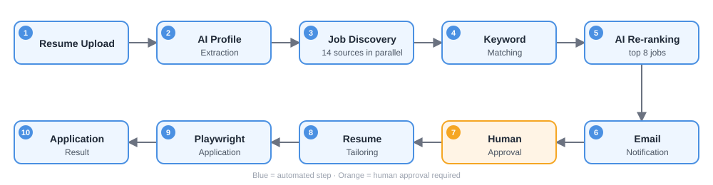

<div align="center">

# 🚀 AI Job Automation · Easy Apply

### Discover → Match → Tailor → Approve → Apply

An AI-powered career assistant that finds relevant jobs, scores them against your profile,<br>
tailors your resume for each one, asks for your approval, and applies on your behalf.


**[Quick Start](#-quick-start) · [Architecture](#-architecture) · [Performance](#-performance-138-ms--30-ms) · [Docker](#-docker) · [API](#-api)**

</div>

---

## ⚡ Quick Start

```bash
git clone https://github.com/Parul101shah/AI_JobAutomation_EasyApply.git
cd AI_JobAutomation_EasyApply

# create .env: DB_PASSWORD, OPENAI_KEY, MAIL_USER, MAIL_APP_PASSWORD
docker compose up -d
```

🌐 Open **http://localhost:8080**  ·  Run locally instead: `./mvnw spring-boot:run` (Java 17 + PostgreSQL)

---

## 🏗️ Architecture

```
            Browser UI  ·  Postman  ·  Email links
                           │  REST
 ┌─────────────────────────▼─────────────────────────┐
 │  🎮 Controllers                                    │
 │     Users · Discovery · Match · Resumes · Apply   │
 ├───────────────────────────────────────────────────┤
 │  ⚙️  Services                                      │
 │     Profile + AI extractor │ Discovery (parallel) │
 │     Match engine           │ Resume tailor + PDF  │
 │     Email notifications    │ Apply (Playwright)   │
 ├───────────────────────────────────────────────────┤
 │  🧵 Thread pools                                   │
 │     fetch (16) · discovery (8) · scoring (5)      │
 │     · apply (2)                                   │
 ├───────────────────────────────────────────────────┤
 │  🗃️  Spring Data JPA                               │
 └─────────────────────────┬─────────────────────────┘
                           │
   🐘 PostgreSQL · 🌱 Greenhouse & Lever · 🤖 OpenAI · 📧 Gmail SMTP
```
## ⚡ Overall Workflow

<div align="center">



</div>

---

## ⚡ Performance: 138 ms → 30 ms

<div align="center">

| | Before (sequential) | After (multithreaded) | Gain |
|:---|:---:|:---:|:---:|
| ⏱️ **Response time** | 138 ms | **30 ms** | 🚀 **4.6× faster (−78.3%)** |

</div>

> [!TIP]
> Verify it yourself from the app's built-in timing logs:
> `docker compose logs app | grep -E "matchJobs total time|notifyHigh endpoint returned|Job discovery completed"`

| # | Proof (from code) | Number |
|:-:|:---|:---:|
| 1 | Job sources fetched concurrently | **14 boards**, 1 wave |
| 2 | Fetch thread pool | **16 threads** ≥ 14 boards |
| 3 | Worst case if a board hangs | **10 s** vs **140 s** sequential |
| 4 | HTTP timeouts | **3 s** connect · **8 s** read |
| 5 | AI calls limited to shortlist | **≤ 8** vs up to 50 (**−84%**) |
| 6 | AI scoring rounds | **2** rounds vs 8 (5 threads) |
| 7 | Prompt size caps | **3000 / 4000 / 2000** chars |
| 8 | `/notify` endpoint | **HTTP 202** instantly, work in background |

---

## ✨ What Makes It Different

| | Feature | Why it matters |
|:-:|:---|:---|
| 🎯 | **Hybrid scoring** | Keyword engine (80%) + LLM judgement (20%); falls back to keyword-only if AI fails |
| ⚙️ | **Config-driven matching** | Weights, thresholds, role & skill aliases in `application.yml` — no redeploy |
| 🙋 | **Human-in-the-loop** | Nothing applied without a click · one-time tokens expire in **7 days** · **dry-run on by default** |
| 🛡️ | **Truthful AI** | Resume prompts forbid invented facts · sensitive (EEO) questions never auto-answered |
| 🔌 | **Per-ATS strategies** | Greenhouse & Lever today · a new platform is one new class |
| 🧯 | **Fail-safe** | CAPTCHA or unknown required question → `NEEDS_MANUAL`, never guessed |

## 🔧 Optimizations

| Area | What |
|:---|:---|
| 🧵 **Concurrency** | `CompletableFuture` fan-out, dedicated pools, per-task timeout + fallback |
| 💰 **Cost** | AI only for top 8 jobs with keyword score ≥ 20 |
| ⚖️ **Fairness** | Round-robin merge across boards before applying the limit |
| 🗃️ **Data** | De-duplication · unique constraint per `(user, source, job)` |
| 🔒 **Race safety** | Atomic `UPDATE … WHERE status = PENDING` for token claim |
| 🧰 **Resources** | One shared Chromium, new browser context per application |
| 🐳 **Docker** | Multi-stage build, Playwright browsers preinstalled |

---

## 🔌 API

| Method | Endpoint | Purpose |
|:-:|:---|:---|
| `POST` | `/api/users/register` | Create profile |
| `POST` | `/api/users/{id}/upload-resume` | Upload PDF → AI-extracted profile |
| `POST` | `/api/users/{id}/confirm-profile` | Save reviewed profile |
| `POST` | `/api/jobs/discovery/run` | Discover jobs |
| `POST` | `/api/jobs/match/{userId}` | Discover + score + rank |
| `POST` | `/api/jobs/match/{userId}/notify` | Async: email HIGH matches |
| `GET` `POST` | `/api/resumes/confirm/{token}` | Approve → build tailored resume |
| `GET` | `/api/resumes/{id}/pdf` | Download resume |
| `GET` `POST` | `/api/applications/apply/{token}` | Approve → auto-apply |

**Status flow:** `PENDING` → `CONFIRMED` → `COMPLETED` · `APPLYING` → `APPLIED` / `NEEDS_MANUAL` / `FAILED`

---

## 🐳 Docker

| Service | Image | Port | Notes |
|:---|:---|:-:|:---|
| `db` | `postgres:16` | 5432 | Healthcheck + `pgdata` volume |
| `app` | `myjobautomation00/jobautomation:v1` | 8080 | Starts after `db` is healthy · `shm_size: 1gb` for Chromium |

**Multi-stage `Dockerfile`**
1. 🔨 **Build** — `maven:3.9-eclipse-temurin-17` compiles and packages the JAR
   2. 🚀 **Run** — `mcr.microsoft.com/playwright/java:v1.49.0-jammy` with browsers preinstalled

```bash
docker compose up -d             # start db + app
docker compose logs -f app       # stream logs
docker compose down              # stop
docker compose down -v           # stop + delete DB data
docker build -t jobautomation .  # build image locally
```

> [!NOTE]
> Create a `.env` file with `DB_PASSWORD`, `OPENAI_KEY`, `MAIL_USER`, `MAIL_APP_PASSWORD`. Never commit it.
> Apply screenshots are saved to `./apply-screenshots`.

---

## 📁 Structure

```
src/main/java/org/example/jobautomation/
├── config/        Thread pools · RestTemplate timeouts · CORS
├── controller/    REST endpoints
├── service/       discovery · match · notification · resume · apply
├── strategy/      Greenhouse / Lever apply strategies
├── entity/        UserProfile · ResumeConfirmation · GeneratedResume
└── repository/    Spring Data JPA
```

---

<div align="center">

**Java 17 · Spring Boot 4.1.1 · Spring AI 2.0.1 · PostgreSQL 16 · Playwright 1.49 · PDFBox / OpenPDF · Docker**

Built for learning and portfolio purposes · ⭐ Star the repo if you find it useful!

</div>
